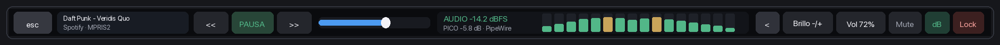
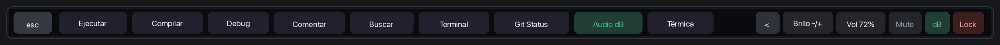
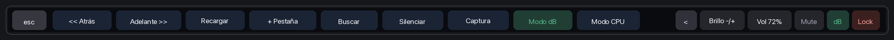
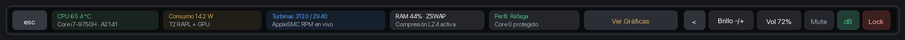
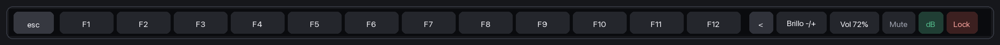

# TuxBar Pro — Suite Completa de Touch Bar para MacBook Pro T2 en Linux

**Autor:** Juan Monzón · `@mylnzon58`  
**Web del proyecto:** https://mylnzon58.github.io/tuxbar-pro/  
**Licencia:** MIT  

**TuxBar Pro** lleva al Touch Bar OLED (`2170 × 60`) de la **MacBook Pro 16" 2019 (A2141)** y otros Mac con chip Apple T2 en **Linux (Ubuntu 24.04 LTS / kernel `linux-t2`)** todas las funcionalidades prácticas del Touch Bar de macOS junto con telemetría de audio en decibeles (`dBFS`) y sensores térmicos en tiempo real.

---

## Todas las vistas y funciones incluidas (Imágenes reales del renderizador)

### 1. Reproductor Multimedia (MPRIS2) + Vúmetro de Decibeles (`dBFS`) en vivo por PipeWire
Controla Spotify, Chrome, YouTube Music, Firefox o VLC con carátula/título, Play/Pausa, barra de progreso táctil y **medidor en tiempo real de `dBFS` RMS y Pico (`-60 dB` a `0 dB`)** directo desde la salida de PipeWire / PulseAudio.



### 2. Perfiles Dinámicos por Aplicación Activa (IDE / Terminal y Navegador)
Detecta automáticamente la ventana enfocada y adapta los botones del Touch Bar igual que en macOS:





### 3. Telemetría Térmica y de Ventiladores A2141 en el Touch Bar
Muestra en tiempo real temperatura de CPU (`coretemp`), consumo (`RAPL`), RPM de ambas turbinas (`applesmc`) y uso de RAM/ZSWAP sin abrir ventanas en pantalla.



### 4. Modo Teclas de Función clásicas (`Fn` → `F1–F12`)
Acceso rápido a `Esc` y `F1–F12` manteniendo siempre la franja de control derecha.



### 5. Control Strip Expandido estilo macOS
Brillo de pantalla, brillo de teclado, vista de ventanas, lanzador de apps, multimedia, volumen, acceso directo a `dB Live`, No Molestar y bloqueo de pantalla.


---

## Transparencia total: Qué funciona en Linux y qué NO se puede extraer de macOS

Para ser 100 % honesto con quienes prueben este proyecto:

| Funcionalidad | Estado en Linux (`TuxBar Pro`) | Explicación técnica |
| :--- | :--- | :--- |
| **Control Strip (Brillo, Vol, Teclado, Lock)** | **Funciona 100 %** | Dibujado por DRM/KMS (`2170 × 60`) + eventos `uinput`/`evdev`. |
| **Reproductores de música + barra táctil** | **Funciona 100 %** | Vía estándar **MPRIS2 D-Bus** (`playerctl`: Spotify, Chrome, VLC, Firefox). |
| **Telemetría de audio en decibeles (`dBFS`)** | **Funciona 100 %** | Lectura PCM 48 kHz desde `@DEFAULT_MONITOR@` en **PipeWire / PulseAudio**. |
| **Teclas `Esc` y `F1–F12`** | **Funciona 100 %** | Inyección directa de eventos de teclado mediante `/dev/uinput`. |
| **Botones dinámicos por aplicación** | **Funciona vía X11 / WM** | Detecta ventana activa por `WM_CLASS` y cambia perfil (no usa APIs privadas de Apple). |
| **Telemetría CPU / RPMs A2141** | **Funciona 100 %** | Lee `/sys/class/hwmon` (`coretemp`) y `/sys/devices/platform/applesmc.*`. |
| **Touch ID (huella en el botón de encendido)** | **No incluido / Limitado** | En el chip Apple T2 está cifrado dentro del **Secure Enclave** propietario. |
| **Botones privados `NSTouchBar` de apps de macOS** | **No extraíble** | Protocolo cerrado de Apple para apps exclusivas de macOS; se recrea con perfiles Linux. |

---

## Requisitos e instalación en Linux (Ubuntu 24.04 LTS + `linux-t2`)

```bash
git clone https://github.com/mylnzon58/tuxbar-pro.git
cd tuxbar-pro
chmod +x install.sh uninstall.sh
sudo ./install.sh
```

*(Nota de desarrollo: los módulos en Python, el puente C `libdrm` y las tiras visuales `2170 × 60` fueron diseñados y validados sintácticamente antes de publicar; la compilación de `libtuxbar_hw.so` contra `libdrm-dev` y la ejecución sobre `/dev/dri/card*` se realizan directamente en Linux T2 mediante `sudo ./install.sh`).*

---

## Apoyo al proyecto y contacto

Comparto esta suite de manera libre y con humildad para la comunidad de MacBooks con Linux T2. Si te fue de utilidad, **dejar una estrella (Star) en el repositorio** ayuda mucho a que más personas puedan encontrarla:

- **Estrella en GitHub:** Presiona **Star** arriba a la derecha en este repositorio
- **GitHub Sponsors:** [github.com/sponsors/mylnzon58](https://github.com/sponsors/mylnzon58)
- **Patreon:** [patreon.com/JuanjoClassic](https://www.patreon.com/JuanjoClassic)
- **Invitar un Tecito:** [tecito.app/juanjoclassic](https://tecito.app/juanjoclassic)
- **LinkedIn:** [Juan José Monzón](https://www.linkedin.com/in/juan-m-97b85681/)
