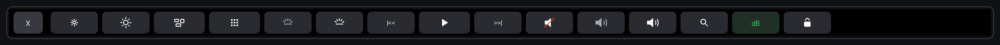
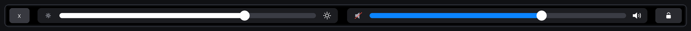
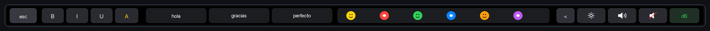
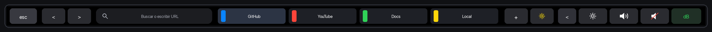
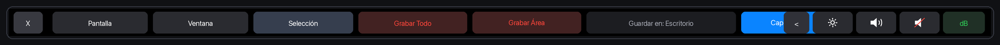
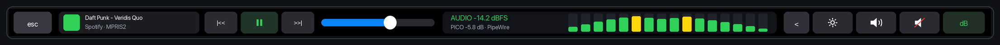
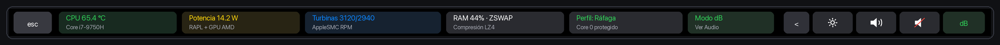
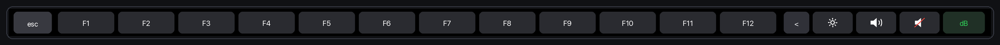

# TuxBar Pro — Suite Completa de Touch Bar para MacBook Pro T2 en Linux

**Autor:** Juan Monzón · `@mylnzon58`  
**Web del proyecto:** https://mylnzon58.github.io/tuxbar-pro/  
**Licencia:** MIT  

**TuxBar Pro** abstrae y replica en Linux (`Ubuntu 24.04 LTS` + kernel `linux-t2`) la experiencia visual y funcional completa del Touch Bar OLED (`2170 × 60`) de macOS con íconos vectoriales de alta nitidez (renderizado *supersampled 2x*), sumando además **telemetría de audio en decibeles (`dBFS`) por PipeWire** y **sensores térmicos A2141 en vivo**.

---

## Todas las funcionalidades e imágenes reales del renderizador (`2170 × 60`)

### 1. Control Strip Expandido estilo macOS (con íconos vectoriales)
Brillo de pantalla (`- / +`), Mission Control, Launchpad, retroiluminación de teclado (`- / +`), controles multimedia (`|<<`, Play, `>>|`), silencio, volumen (`- / +`), lupa Spotlight, acceso rápido `dB` y bloqueo de pantalla.



### 2. Deslizadores Táctiles de Brillo y Volumen (`Slider Popover`)
Barras deslizantes interactivas idénticas a macOS para ajustar brillo y volumen arrastrando el dedo.



### 3. Barra de Escritura (`Typing Bar`): Formato, Texto Predictivo e Íconos Emoji
Al escribir en editores o chats: botones de formato (`B`, `I`, `U`, color `A`), sugerencias predictivas de palabras y selector rápido de emojis junto al Control Strip derecho.



### 4. Barra de Navegador Web con Miniaturas de Pestañas
Botones Atrás/Adelante, barra de búsqueda/URL, selector visual de pestañas abiertas, `+` nueva pestaña y Control Strip derecho.



### 5. Barra de Captura y Grabación de Pantalla
Captura de pantalla completa, ventana, selección, grabación de video y carpeta de destino.



### 6. Reproductor MPRIS2 + Vúmetro de Decibeles (`dBFS`) en vivo por PipeWire
Controla Spotify, Chrome, YouTube Music, Firefox o VLC con barra de progreso táctil y **medidor de decibeles `RMS` y `Pico` (`-60 dB` a `0 dB`)** con 16 bandas en tiempo real directo desde PipeWire.



### 7. Telemetría Térmica y Ventiladores A2141 en el OLED
Temperatura de CPU (`coretemp`), consumo (`RAPL`), RPM de ambas turbinas (`applesmc`), RAM/ZSWAP y acceso al modo audio `dB`.



### 8. Teclas de Función Clásicas (`Esc` + `F1–F12` + Control Strip)
Fila completa `F1` a `F12` con íconos vectoriales de brillo, volumen, silencio y `dB` a la derecha.



---

## Transparencia total: Qué funciona en Linux y qué NO se puede extraer de macOS

| Funcionalidad | Estado en Linux (`TuxBar Pro`) | Explicación técnica |
| :--- | :--- | :--- |
| **Control Strip + Íconos Vectoriales + Sliders** | **Funciona 100 %** | Renderizado *2x supersampled* por DRM/KMS (`2170 × 60`) + `evdev`/`uinput`. |
| **Reproductores de música + barra táctil** | **Funciona 100 %** | Vía estándar **MPRIS2 D-Bus** (`playerctl`: Spotify, Chrome, VLC, Firefox). |
| **Telemetría de audio en decibeles (`dBFS`)** | **Funciona 100 %** | Lectura PCM 48 kHz desde `@DEFAULT_MONITOR@` en **PipeWire / PulseAudio**. |
| **Teclas `Esc`, `F1–F12` y Atajos de App** | **Funciona 100 %** | Inyección directa mediante `/dev/uinput` y detección por `WM_CLASS`. |
| **Telemetría CPU / RPMs A2141** | **Funciona 100 %** | Lee `/sys/class/hwmon` (`coretemp`) y `/sys/devices/platform/applesmc.*`. |
| **Touch ID (huella en el botón de encendido)** | **No incluido / Limitado** | En el chip Apple T2 está cifrado dentro del **Secure Enclave** propietario. |
| **Protocolo privado `NSTouchBar` de Apple** | **No extraíble** | Exclusivo de apps nativas de macOS; se recrea con perfiles de ventana en Linux. |

---

## Instalación en Linux (Ubuntu 24.04 LTS + `linux-t2`)

```bash
git clone https://github.com/mylnzon58/tuxbar-pro.git
cd tuxbar-pro
chmod +x install.sh uninstall.sh
sudo ./install.sh
```

---

## Apoyo al proyecto y contacto

Comparto esta suite de manera libre y con humildad para la comunidad de MacBooks con Linux T2. Si te fue de utilidad, **dejar una estrella (Star) en el repositorio** ayuda mucho a que más personas puedan encontrarla:

- **Estrella en GitHub:** Presiona **Star** arriba a la derecha en este repositorio
- **GitHub Sponsors:** [github.com/sponsors/mylnzon58](https://github.com/sponsors/mylnzon58)
- **Patreon:** [patreon.com/JuanjoClassic](https://www.patreon.com/JuanjoClassic)
- **Invitar un Tecito:** [tecito.app/juanjoclassic](https://tecito.app/juanjoclassic)
- **LinkedIn:** [Juan José Monzón](https://www.linkedin.com/in/juan-m-97b85681/)
